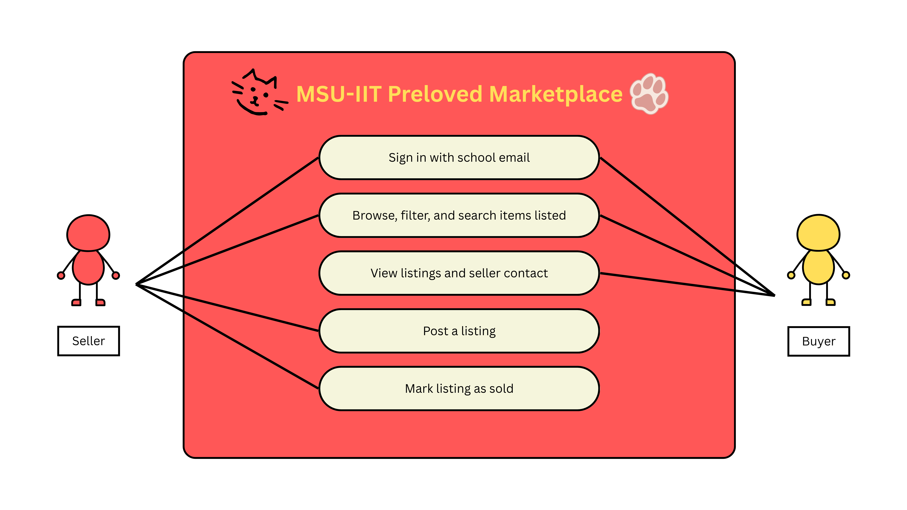

# Product Backlog

## Team Information

- Team name: Task 4orce
- Project title: MSU-IIT Preloved Marketplace
- Primary user group for the first release: MSU-IIT student buyers looking for secondhand school materials
- Format: User stories with one use case

| Member | GitHub username | Personal CSC181 repository |
| --- | --- | --- |
| Shasheenah Deeneille C. Lumasag | shasheenahdeeneillelumasag | [https://github.com/shasheenahdeeneillelumasag/csc181](https://github.com/shasheenahdeeneillelumasag/csc181) |
| Rogelio Angelo C. Bollozos | angelobollozos | [https://github.com/angelobollozos/CSC181](https://github.com/angelobollozos/CSC181) |
| Raven L. Cosning | RavenCosning | [https://github.com/RavenCosning/CSC181](https://github.com/RavenCosning/CSC181) |
| Dave Jared S. Gabuat | davejared-blip | [https://github.com/davejared-blip/CSC181](https://github.com/davejared-blip/CSC181) |

## 1. Interview Summary

| Code | Stakeholder role | Date | Method | Interviewer(s) |
| --- | --- | --- | --- | --- |
| V1 | Seller, 3rd year | 2026-10-21 | Online via Facebook Messenger Chat | Shasheenah Deeneille Lumasag |
| V2 | Buyer, 2nd year | 2026-10-23 | Face-to-Face Interview | Raven Cosning |
| O1 | Buyer, 4th year | 2026-10-23 | Online via Facebook Messenger Chat | Rogelio Angelo Bollozos |
| O2 | Buyer, 1st year | 2026-10-23 | Online via Facebook Messenger Chat | Dave Gabuat |
| O3 | Buyer, 3rd year | 2026-10-21 | Online via Facebook Messenger Chat | Shasheenah Deeneille Lumasag |
| O4 | Buyer, 4th year | 2026-10-23 | Face-to-Face Interview | Raven Cosning |
| O5 | Buyer, 2nd year | 2026-10-23 | Online via Facebook Messenger Chat | Dave Gabuat |

## 2. From Interview Notes to Needs

| ID | Source | What we heard or saw | Underlying need | Requirement idea | Type |
| --- | --- | --- | --- | --- | --- |
| F1 | V1 | "if walay engagement sa posts like comments or reacts." | Have a listing seen without depending on likes or comments | Every active listing appears on a browse page, sorted by newest first, whether or not it has any reactions. | F |
| F2 | V1 | "If no one is interested to buy or the admin of the page take so long to approve the post." | Get a listing seen without waiting for admin approval or reactions | A signed-in student can publish a listing immediately, without admin approval. | F |
| F3 | V1 | "Categorized items sa mga gipang sell i think. Para ma focus pd og pangita ang buyers" | Reach buyers looking for that kind of item | Each listing requires a category, and buyers can browse by category. | F |
| F4 | O3 | "Typically 1-2 days pero if ang total hours lang ana nga na spend kay around 3-5 hrs kay dugay man makita and usahay wala pa na post sa seller" | Find a specific item quickly, without checking many groups | Keyword search by item title and course, combined with category filters. | F |
| F5 | O3 | "Item condition and the quality" | Judge condition before meeting the seller | Each listing requires a photo and a condition chosen from a short list. | F |
| F6 | V2 | "I messaged my friend asking if she was available and if the textbook I was looking for was still for sale." | Know whether an item is still available before messaging | A seller can mark a listing as sold. The site then removes it from search results and deletes its contact details. | F |
| F7 | O4 | "Based on my experience, I doubt the products since Facebook only serves as something similar to a middleman." | Trust that the seller is a real MSU-IIT student | Only @g.msuiit.edu.ph accounts can register and see contact details. Ratings and enrollment checks are out of scope, so this is a partial answer. | F |
| F8 | O1 | "I bought a phone. We met up in a crowded place so I could check the phone's condition. Payment terms were in cash." | Inspect the item and pay safely in person | The site handles no payments or delivery. Buyer and seller agree on price, payment, and a campus meetup themselves. | C |

### Assumption log

| ID | Assumption | Risk if wrong (High/Medium/Low) | How we will check it |
| --- | --- | --- | --- |
| A1 | Seniors and graduating students have unused school materials and will list them on a new platform. | High | Interview at least 3 more sellers, ideally seniors. Ask what school materials they still own and what they did the last time they sold something. |
| A2 | Underclassmen will search our platform instead of scrolling Facebook groups. | High | Ask 5 underclassmen where they last looked for secondhand items and what would make them switch. Then run the timed search test. |
| A3 | Sellers will accept showing their Facebook link or mobile number to other MSU-IIT students. | Medium | Show the posting-notice wording to the seller/s we interview. Record how many would still post. |
| A4 | Free hosting and login tools can support @g.msuiit.edu.ph sign-in for the prototype. | Medium | Test registration with all 4 members' accounts on day 1 of Sprint 1. |

## 3. User Stories

| ID | User story | Source finding(s) | Epic | INVEST check |
| --- | --- | --- | --- | --- |
| US-01 | As an MSU-IIT student seller, I want my listing to be published immediately after I submit it, without waiting for administrator approval, so that buyers can see the item sooner. | F2 | Manage a listing | Yes |
| US-02 | As an MSU-IIT student seller, I want to add a photo to my listing, so that buyers can inspect the item's appearance before contacting me. | F5 | Manage a listing | Yes |
| US-03 | As an MSU-IIT student seller, I want to select the item's condition from a predefined list, so that buyers know its quality before meeting me. | F5 | Manage a listing | Yes |
| US-04 | As an MSU-IIT student seller, I want to assign a category to my listing, so that buyers can find it while browsing that type of item. | F3 | Manage a listing | Yes |
| US-05 | As an MSU-IIT student seller, I want to mark my listing as sold, so that buyers know the item is no longer available. | F6 | Manage a listing | Yes |
| US-06 | As an MSU-IIT student buyer, I want to browse active listings in newest-first order, including listings with no reactions, so that I can see available items without relying on Facebook engagement. | F1 | Find an item to buy | Yes |
| US-07 | As an MSU-IIT student buyer, I want to search listings by item title or course, so that I can find specific school materials without checking several Facebook groups. | F4 | Find an item to buy | Yes |
| US-08 | As an MSU-IIT student buyer, I want to filter listings by category, so that I can narrow the results to the type of item I need. | F3, F4 | Find an item to buy | Yes |
| US-09 | As an MSU-IIT student buyer, I want to view a listing's photo and stated condition, so that I can assess the item before meeting the seller. | F5 | Find an item to buy | Yes |
| US-10 | As an MSU-IIT student buyer, I want sold listings to be excluded from search results, so that I do not waste time contacting sellers about unavailable items. | F6 | Find an item to buy | Yes |
| US-11 | As an MSU-IIT student, I want marketplace registration to accept only @g.msuiit.edu.ph email addresses, so that access is limited to the MSU-IIT community. | F7 | Trust and meetup | Yes |
| US-12 | As an MSU-IIT student buyer, I want to view the seller's contact details on an active listing, so that I can contact the seller and arrange an in-person inspection. | F7, F8 | Trust and meetup | Yes |
| US-13 | As an MSU-IIT student seller, I want to enter my item's title and course when I create a listing, so that buyers can find it through search. | F4 | Manage a listing | Yes |
| US-14 | As an MSU-IIT student seller, I want to provide my contact details on my listing, so that interested buyers can reach me to arrange a meetup. | F7, F8 | Trust and meetup | Yes |

### Epics and how we split them

| Epic | Split into | How we split it |
| --- | --- | --- |
| Manage a listing | US-01, US-02, US-03, US-04, US-05, US-13 | By workflow step. We divided listing management into publishing a listing, entering the item's title and course, adding a photo, specifying the item's condition, assigning a category, and marking the item as sold. |
| Find an item to buy | US-06, US-07, US-08, US-09, US-10 | By workflow step. We divided the buying process into browsing listings, searching by keywords, filtering by category, viewing item details, and excluding sold listings. |
| Trust and meetup | US-11, US-12, US-14 | By business rule and coordination step. We separated restricting marketplace access through school email registration from providing and viewing seller contact details to arrange an in-person inspection. |

### Stories we rewrote

1. Before: As a buyer, I want every seller to be verified as an MSU-IIT student through their school email, so that I can trust the person I am buying from.

   After: As an MSU-IIT student, I want marketplace registration to accept only @g.msuiit.edu.ph email addresses, so that access is limited to the MSU-IIT community.

   Reason: The original story did not clearly meet the Testable quality of INVEST because trusting a seller is subjective and cannot be guaranteed through email verification alone. The revised story focuses on a specific requirement that can be tested: whether the system accepts only accounts using the required school email domain.

2. Before: As a buyer, I want to see the seller's contact details on a listing, so that I can arrange to inspect the item and pay in person.

   After: As an MSU-IIT student buyer, I want to view the seller's contact details on an active listing, so that I can contact the seller and arrange an in-person inspection.

   Reason: The original story was not sufficiently Small because it included viewing contact details, arranging an inspection, and making an in-person payment. The revised story focuses on displaying contact details, which is the specific function provided by the marketplace. The buyer and seller handle the inspection and payment themselves.

## 4. Acceptance Criteria

### US-01: Publish a listing without admin approval

Acceptance criteria:

- [ ] When a signed-in seller submits a listing with every required field filled (title, course, and contact details), the listing's status becomes Active and it appears on the browse page within 5 seconds.
- [ ] No step, queue, or status named "pending approval" exists between submitting and publishing.
- [ ] After submitting, the seller sees a confirmation message that includes the listing title.
- [ ] (unhappy) If any required field is empty (title, course, or contact details), the listing is not published, the form names each missing field, and the values already entered are kept.
- [ ] (unhappy) A visitor who is not signed in and opens the post-listing page is redirected to the sign-in page.

Scenario 1: Seller publishes a complete listing

```gherkin
Given a seller is signed in as sample1@g.msuiit.edu.ph and the form has title 'Calculus 8th Edition', course 'MAT061', and contact '09000000000'
When the seller selects Publish
Then the listing 'Calculus 8th Edition' appears at the top of the browse page within 5 seconds and the seller sees the confirmation 'Calculus 8th Edition is now live' and no approval step is shown
```

Scenario 2: Required field is empty (unhappy)

```gherkin
Given a seller is signed in and the form has every field filled except the title
When the seller selects Publish
Then the listing is not published and the form shows 'Title is required' and the course and contact values are still filled in
```

### US-02: Add a photo to a listing

Acceptance criteria:

- [ ] The photo field accepts JPG and PNG files of up to 10 MB.
- [ ] After a file is chosen, a preview of the photo is shown before the seller publishes.
- [ ] A listing cannot be published without a photo.
- [ ] The photo is shown on the listing's page and on its card on the browse page.
- [ ] (unhappy) A file that is not JPG or PNG, or is larger than 10 MB, is rejected with the message 'Only JPG or PNG files up to 10 MB are allowed', and no photo is attached.

Scenario 1: Seller attaches a valid photo

```gherkin
Given a seller is signed in and is creating a listing
When the seller chooses 'gown.jpg' (2 MB)
Then a preview of 'gown.jpg' is shown on the form and the listing can be published with that photo
```

Scenario 2: Seller attaches a file that is not allowed (unhappy)

```gherkin
Given a seller is signed in and is creating a listing
When the seller chooses 'notes.pdf' (300 KB)
Then the form shows 'Only JPG or PNG files up to 10 MB are allowed' and no photo is attached and the Publish button does not publish the listing
```

### US-03: Select the item's condition

Acceptance criteria:

- [ ] The condition field is a drop-down list with exactly four options: Like new, Good, Fair, Poor. Free text is not accepted.
- [ ] The selected condition is shown on the listing's page and on its card on the browse page.
- [ ] A listing cannot be published without a selected condition.
- [ ] (unhappy) If the seller submits without selecting a condition, the form shows 'Select a condition' and the listing is not published.

Scenario 1: Seller selects a condition

```gherkin
Given a seller is signed in and is creating a listing
When the seller opens the condition list and selects 'Fair'
Then the form shows 'Fair' as the selected condition and after publishing, the listing's page and browse card show 'Fair'
```

Scenario 2: Seller skips the condition (unhappy)

```gherkin
Given a seller is signed in and every other required field is filled and no condition is selected
When the seller selects Publish
Then the listing is not published and the form shows 'Select a condition'
```

### US-04: Assign a category to a listing

Acceptance criteria:

- [ ] The category field is a drop-down list with exactly five options: Textbooks, Lab gowns and uniforms, Drafting tools, Calculators, Other.
- [ ] A listing cannot be published without a selected category.
- [ ] A published listing appears in the results when a buyer filters by its category.
- [ ] (unhappy) If the seller submits without a category, the form shows 'Select a category' and the listing is not published.

Scenario 1: Seller assigns a category

```gherkin
Given a seller is signed in and is creating a listing titled 'Drafting set'
When the seller selects the category 'Drafting tools' and publishes
Then the listing 'Drafting set' appears when a buyer filters by 'Drafting tools' and it does not appear when a buyer filters by 'Textbooks'
```

Scenario 2: Seller skips the category (unhappy)

```gherkin
Given a seller is signed in and every other required field is filled and no category is selected
When the seller selects Publish
Then the listing is not published and the form shows 'Select a category'
```

### US-05: Mark a listing as sold

Acceptance criteria:

- [ ] The 'Mark as sold' button is shown only to the seller who created the listing, and only while the listing is Active.
- [ ] The system asks for confirmation before it changes the status.
- [ ] After confirmation, the status becomes Sold and the listing's contact details are no longer displayed.
- [ ] (unhappy) If the seller selects Cancel on the confirmation, the listing stays Active and stays visible.
- [ ] (unhappy) A signed-in student who is not the listing's seller does not see the button, and a direct request to mark the listing as sold is refused with 'Not allowed' and leaves the status unchanged.

Scenario 1: Seller marks an item as sold

```gherkin
Given a seller is signed in and the seller has an Active listing 'Lab gown size M'
When the seller selects 'Mark as sold' and confirms
Then the status of 'Lab gown size M' becomes Sold and the listing page no longer shows the seller's contact details
```

Scenario 2: Another student tries to mark it as sold (unhappy)

```gherkin
Given a student is signed in as sample2@g.msuiit.edu.ph and an Active listing 'Lab gown size M' belongs to sample1@g.msuiit.edu.ph
When sample2@g.msuiit.edu.ph opens 'Lab gown size M'
Then no 'Mark as sold' button is shown and a direct request to mark it as sold is refused with 'Not allowed' and the listing stays Active
```

### US-06: Browse active listings, newest first

Acceptance criteria:

- [ ] The browse page lists every Active listing in order of publish time, newest first.
- [ ] A listing appears at its publish-time position even if no one has viewed it or contacted the seller.
- [ ] Each listing card shows its title and course, plus its photo, category, and condition once US-02, US-03, and US-04 are built.
- [ ] (unhappy) When there are no Active listings, the page shows 'No listings yet' instead of an empty page.

Scenario 1: Newest listing comes first

```gherkin
Given three Active listings were published at 08:00, 09:00, and 10:00 on 2026-11-02 and the 08:00 listing has never been viewed
When a buyer opens the browse page
Then the listings are shown in the order 10:00, 09:00, 08:00
```

Scenario 2: No active listings (unhappy)

```gherkin
Given no listing has the status Active
When a buyer opens the browse page
Then the page shows 'No listings yet'
  And no listing cards are shown
```

### US-07: Search by item title or course

Acceptance criteria:

- [ ] A keyword search returns every Active listing whose title or course contains the keyword, ignoring upper and lower case.
- [ ] Results appear within 3 seconds and are ordered newest first.
- [ ] Sold listings are never part of the results.
- [ ] (unhappy) When no listing matches, the page shows the message 'No listings found for' followed by the keyword the buyer typed, and a link that clears the search.
- [ ] (unhappy) If the buyer submits an empty search, the page shows all Active listings, newest first.

Scenario 1: Buyer searches by keyword

```gherkin
Given the Active listings are 'Calculus 8th Edition' (course MAT061) and 'Lab gown size M' (course BIO101) and 'Calculus 7th Edition' has the status Sold
When a buyer searches for 'calculus'
Then the results show only 'Calculus 8th Edition' and 'Calculus 7th Edition' is not shown
```

Scenario 2: Nothing matches (unhappy)

```gherkin
Given the Active listings are 'Calculus 8th Edition' and 'Lab gown size M'
When a buyer searches for 'zzzz'
Then the page shows 'No listings found for zzzz' and a link to clear the search is shown
```

### US-08: Filter listings by category

Acceptance criteria:

- [ ] Selecting a category shows only Active listings in that category.
- [ ] A category filter and a keyword search can be used together, and the results match both.
- [ ] Clearing the filter shows all Active listings again.
- [ ] (unhappy) If the selected category has no Active listings, the page shows the message 'No listings in' followed by the selected category name.

Scenario 1: Buyer filters by category and keyword

```gherkin
Given Active listings: 'Calculus 8th Edition' (Textbooks), 'Physics 1 Notes' (Textbooks), and 'Scientific calculator' (Calculators)
When a buyer selects the category 'Textbooks' and searches for 'calculus'
Then the results show only 'Calculus 8th Edition'
```

Scenario 2: Category has no listings (unhappy)

```gherkin
Given no Active listing has the category 'Drafting tools'
When a buyer selects the category 'Drafting tools'
Then the page shows 'No listings in Drafting tools' and no listing cards are shown
```

### US-09: View a listing's photo and condition

Acceptance criteria:

- [ ] Selecting a listing card opens the listing page, which shows the photo, title, course, category, condition, and the date it was published.
- [ ] Selecting the photo opens a larger view of it.
- [ ] (unhappy) If the photo file cannot be loaded, the page shows a placeholder with 'Photo unavailable', and the condition and other details are still shown.
- [ ] (unhappy) If the listing's status is Sold, the page shows 'This item has been sold' and no contact details.

Scenario 1: Buyer opens a listing

```gherkin
Given an Active listing 'Lab gown size M' has category 'Lab gowns and uniforms', condition 'Good', and course 'BIO101'
When a buyer selects its card on the browse page
Then the listing page shows the photo, 'Lab gown size M', 'BIO101', 'Lab gowns and uniforms', and 'Good'
```

Scenario 2: Photo fails to load (unhappy)

```gherkin
Given an Active listing 'Lab gown size M' whose photo file cannot be loaded
When a buyer opens its listing page
Then the page shows a placeholder with 'Photo unavailable' and the condition 'Good' is still shown
```

### US-10: Exclude sold listings from results

Acceptance criteria:

- [ ] A listing with the status Sold does not appear on the browse page, in search results, or in category filter results.
- [ ] The listing disappears from all three within 5 seconds of being marked as sold.
- [ ] The seller's other Active listings remain visible.
- [ ] (unhappy) A buyer who opens a saved link to a Sold listing sees 'This item has been sold' and no contact details.

Scenario 1: Sold listing leaves the results

```gherkin
Given a seller has the Active listings 'Calculus 8th Edition' and 'Lab gown size M'
When the seller marks 'Calculus 8th Edition' as sold
Then within 5 seconds a buyer's browse page, search for 'calculus', and 'Textbooks' filter no longer show 'Calculus 8th Edition' and the browse page still shows 'Lab gown size M'
```

Scenario 2: Buyer opens a saved link to a sold item (unhappy)

```gherkin
Given a buyer saved the link to the listing 'Calculus 8th Edition' and the listing's status is now Sold
When the buyer opens the saved link
Then the page shows 'This item has been sold' and no contact details are shown
```

### US-11: Register with an MSU-IIT email only

Acceptance criteria:

- [ ] Registration accepts an email address that ends in @g.msuiit.edu.ph, ignoring upper and lower case, and creates the account.
- [ ] (unhappy) An email address with any other ending, such as @gmail.com or @msuiit.edu.ph, is rejected with 'Use your @g.msuiit.edu.ph email address', and no account is created.
- [ ] (unhappy) An email address that already has an account is rejected with 'This email is already registered. Sign in instead.', and no second account is created.
- [ ] A visitor who is not signed in cannot post a listing or see a seller's contact details.

Scenario 1: Student registers with a school email

```gherkin
Given a visitor is on the registration page
When the visitor registers with 'sample1@g.msuiit.edu.ph'
Then an account is created for 'sample1@g.msuiit.edu.ph' and the visitor is signed in
```

Scenario 2: Visitor uses a personal email (unhappy)

```gherkin
Given a visitor is on the registration page
When the visitor registers with 'sample1@gmail.com'
Then the page shows 'Use your @g.msuiit.edu.ph email address' and no account is created
```

### US-12: View the seller's contact details

Acceptance criteria:

- [ ] A signed-in student who opens an Active listing sees the contact details the seller entered, and no others.
- [ ] (unhappy) A visitor who is not signed in sees 'Sign in with your @g.msuiit.edu.ph email to see contact details' and no contact details.
- [ ] (unhappy) A listing with the status Sold shows no contact details.
- [ ] The contact details are shown on the listing page without the buyer having to send a message first.

Scenario 1: Signed-in buyer sees the contact details

```gherkin
Given a buyer is signed in as sample2@g.msuiit.edu.ph and the Active listing 'Lab gown size M' has the contact '09000000000'
When the buyer opens the listing page
Then the page shows '09000000000'
```

Scenario 2: Visitor is not signed in (unhappy)

```gherkin
Given a visitor is not signed in and the Active listing 'Lab gown size M' has the contact '09000000000'
When the visitor opens the listing page
Then the page shows 'Sign in with your @g.msuiit.edu.ph email to see contact details' and '09000000000' is not shown anywhere on the page
```

### US-13: Enter the item's title and course

Acceptance criteria:

- [ ] The title is required and holds 1 to 100 characters. The course is required and holds 1 to 20 characters.
- [ ] The title and course appear on the listing's page and on its card on the browse page.
- [ ] Once search (US-07) is built, a listing can be found by searching for words in its title or its course.
- [ ] (unhappy) A title longer than 100 characters is rejected with 'Title must be 100 characters or fewer', and the listing is not published.
- [ ] (unhappy) An empty course is rejected with 'Course is required', and the listing is not published.

Scenario 1: Seller enters a title and course

```gherkin
Given a seller is signed in and is creating a listing
When the seller enters the title 'Calculus 8th Edition' and the course 'MAT061' and publishes
Then the browse card and the listing page show 'Calculus 8th Edition' and 'MAT061'
```

Scenario 2: Seller leaves the course empty (unhappy)

```gherkin
Given a seller is signed in and the title is 'Calculus 8th Edition' and the course is empty
When the seller selects Publish
Then the listing is not published and the form shows 'Course is required'
```

### US-14: Provide contact details on a listing

Acceptance criteria:

- [ ] The contact field requires at least one of a Facebook profile link or a mobile number.
- [ ] A mobile number is accepted only when it has 11 digits and starts with 09.
- [ ] Before publishing, the seller sees the notice 'Your contact details will be shown to signed-in MSU-IIT students.'
- [ ] (unhappy) If neither a Facebook link nor a mobile number is entered, the form shows 'Enter a Facebook link or a mobile number' and the listing is not published.
- [ ] (unhappy) A mobile number that is not 11 digits starting with 09 is rejected with 'Enter an 11-digit mobile number that starts with 09'.

Scenario 1: Seller provides a mobile number

```gherkin
Given a seller is signed in and is creating a listing
When the seller enters the mobile number '09000000000' and publishes
Then the notice 'Your contact details will be shown to signed-in MSU-IIT students.' was shown before publishing and the published listing stores '09000000000' as its contact
```

Scenario 2: Seller enters an invalid mobile number (unhappy)

```gherkin
Given a seller is signed in and is creating a listing
When the seller enters the mobile number '12345' and publishes
Then the form shows 'Enter an 11-digit mobile number that starts with 09' and the listing is not published
```

## 5. Quality Requirements and Constraints (EARS)

| ID | Requirement | EARS pattern | Type | Source | Number agreed with |
| --- | --- | --- | --- | --- | --- |
| NFR-01 | When a signed-in student submits a valid listing form, the system shall publish the listing within 5 seconds without requiring administrative review. | Event-driven | Quality | F2 | N/A |
| NFR-02 | The system shall restrict account registration and contact detail visibility exclusively to users authenticated via @g.msuiit.edu.ph email addresses. | Ubiquitous | Constraint | F7 | N/A |
| NFR-03 | The system shall not process payments or track deliveries. | Ubiquitous | Constraint | F8 | N/A |
| NFR-04 | When a user submits a keyword search query or category filter, the system shall return matching search results within 3 seconds. | Event-driven | Quality (performance) | F4 | N/A |

## 6. Use Case

### Use-case diagram



### UC-01: Post a listing

| Field | Description |
| --- | --- |
| Primary actor | Student seller |
| Precondition | The seller is signed in with an @g.msuiit.edu.ph account. |
| Main success scenario | 1. The seller opens the post-listing page. <br> 2. The seller enters the title and course and selects the category and condition. <br> 3. The seller attaches a photo and enters a Facebook link or a mobile number as the contact. <br> 4. The seller reads the notice that contact details will be shown to signed-in MSU-IIT students and selects Publish. <br> 5. The system publishes the listing as Active, shows it at the top of the browse page within 5 seconds, and shows the confirmation like "Title is now live." |
| Extensions | 1a. The seller is not signed in: the system redirects the seller to the sign-in page. <br> 2a. The title is longer than 100 characters: the system shows "Title must be 100 characters or fewer" and does not publish the listing. <br> 2b. The course is empty: the system shows "Course is required" and does not publish the listing. <br> 3a. The photo is not a JPG or PNG file, or is larger than 10 MB: the system shows "Only JPG or PNG files up to 10 MB are allowed" and attaches no photo. <br> 3b. The mobile number does not have 11 digits starting with 09: the system shows "Enter an 11-digit mobile number that starts with 09" and does not publish the listing. <br> 4a. A required field is empty: the system does not publish the listing, names each missing field, and keeps the values already entered. |
| Postcondition | The listing is Active. It appears on the browse page, and signed-in students can see the seller's contact details on it. |
| Stories covered | US-01, US-02, US-03, US-04, US-13, US-14 |

Note: In Sprint 1, steps 2 and 3 cover only the title, course, and contact. The category, condition, and photo are added in Sprint 2.

## 7. Story Map

| | Sign In | Post an item | Browse, filter, and search items listed | View listing and seller contact | Mark listing as sold |
| --- | --- | --- | --- | --- | --- |
| **Release 1 (MVP)** | US-11 | US-13, US-14, US-01 | US-06 | US-12 | US-05 |
| **Release 2** | - | US-02, US-03, US-04 | US-07, US-08 | US-09 | US-10 |
| **Later** | - | - | - | - | - |

## 8. The Ordered Backlog

| Rank | Story | MoSCoW | Size (S/M/L) | Value / effort quadrant | Sprint |
| --- | --- | --- | --- | --- | --- |
| 1 | US-11: Register and restrict access to '@g.msuiit.edu.ph' email addresses | Must | S | Quick win | Sprint 1 |
| 2 | US-13: Enter title and course when creating a listing | Must | S | Quick win | Sprint 1 |
| 3 | US-14: Provide contact details on a listing | Must | S | Quick win | Sprint 1 |
| 4 | US-01: Publish listing immediately without administrative review | Must | M | Quick win | Sprint 1 |
| 5 | US-06: Browse active listings in newest-first order | Must | M | Big bet | Sprint 1 |
| 6 | US-12: View seller contact details on active listings | Must | S | Quick win | Sprint 1 |
| 7 | US-05: Mark a listing as sold | Must | S | Quick win | Sprint 1 |
| 8 | US-02: Add a photo to a listing | Should | M | Big bet | Sprint 2 |
| 9 | US-03: Select item condition from a predefined list | Should | S | Quick win | Sprint 2 |
| 10 | US-09: View a listing's photo and stated condition | Should | S | Quick win | Sprint 2 |
| 11 | US-07: Search listings by item title or course code | Should | M | Big bet | Sprint 2 |
| 12 | US-10: Exclude sold listings from search results | Should | S | Quick win | Sprint 2 |
| 13 | US-04: Assign a category to a listing | Could | S | Quick win | Sprint 2 |
| 14 | US-08: Filter listings by category | Could | S | Quick win | Sprint 2 |

How we ordered it:
The top of the backlog (Rank 1-7) represents the minimum viable walking skeleton (MVP) necessary for a functional peer-to-peer transaction on campus. We placed access control (US-11) and foundational listing attributes (US-13, US-14, US-01) first to establish the data model and remove admin approval bottlenecks. Browse (US-06), seller contacting (US-12), and inventory status management (US-05) complete the end-to-end user journey across all stages. Sprint 2 items (Rank 8-14) focus on filtering and search refinements (photos, condition list, search, and category taxonomy) that add confidence once the baseline transaction loop is proven. US-11 comes first partly because it tests assumption A4 early.

### Capacity check

| Question | Answer |
| --- | --- |
| How many Must-have stories, and their total size? | 7 stories totaling 9 units. (S = 1 unit, M = 2 units where US-11, US-13, US-14, US-12, US-05 are S and US-01, US-06 are M). |
| Do the Must-haves fit in about 60% of our time for two sprints? | Yes. Must-haves take 50% of total effort (9 of 18 units), within the 60% limit. |
| Do the Release 1 stories form one complete path through the core workflow? | Yes. It covers the full flow: Sign in to Post to Browse to View seller contact to Mark as sold. |
| Are all L-sized Must-have stories split? | Yes. There are no L-sized stories in the backlog. All compound workflows have been sliced into S and M stories. |

## 9. Definition of Done

Starting in Sprint 1, a user story is considered 'Done' only when all of the following conditions are met:

- [ ] All acceptance criteria specified for the story (including the unhappy path) are tested and verified on the staging environment.
- [ ] Code is peer-reviewed and approved by at least one team member via a GitHub pull request.
- [ ] The feature renders correctly and remains functional across both mobile and desktop browser views without layout breakage.
- [ ] No console errors or uncaught exceptions occur during execution of the primary user flow.
- [ ] Deployed and verified on the live staging/production web environment.
- [ ] Project documentation and `README.md` are updated if setup steps or app features change.

## 10. Traceability Table

| Story | Problem or goal it addresses | Source finding(s) | Test cases (Week 9) |
| --- | --- | --- | --- |
| US-11 | Trust that the seller is a real MSU-IIT student | F7 | |
| US-13 | Find a specific item quickly, without checking many groups | F4 | |
| US-14 | Meet an MSU-IIT seller in person to inspect the item and pay safely | F7, F8 | |
| US-01 | Get a listing seen without waiting for admin approval or reactions | F2 | |
| US-06 | Have a listing seen without depending on likes or comments | F1 | |
| US-12 | Meet an MSU-IIT seller in person to inspect the item and pay safely | F7, F8 | |
| US-05 | Know whether an item is still available before messaging | F6 | |

Gaps found: During stakeholder feedback (O3), three new feature requests emerged that currently have no user stories: an option for sellers to edit or delete listings, a way to report fake or misleading listings, and displaying a preferred meetup place. Otherwise, every Must-have story traces to at least one finding, and every finding (F1 to F8) has at least one story. Stories for F3, F5, and keyword search (F4) are in Release 2, as planned in Section 7.

## 11. Validation

### Team review

| Problem found | Story or requirement | How we fixed it |
| --- | --- | --- |
| F4 says search by item title “and” course, which could mean both fields must match. US-07 and its criteria say a listing is found if the title “or” course contains the keyword. | F4, US-07 | Reword F4 to "Keyword search by item title or course, combined with category filters,” so it matches US-07. |
| F6 says the site “deletes” the contact details when an item is sold, but US-05 only says they are no longer displayed. | F6, US-05 | Reword F6 so the contact details are no longer displayed but are kept in the listing’s history instead of being deleted. This matches US-05. |

### Stakeholder walk-through

| Stakeholder | Date | What they said | What we changed |
| --- | --- | --- | --- |
| O3, Buyer | 2026-11-09 | "I think the idea is really useful... I would recommend including at least photos and item condition in the first version. As a buyer, I want to see the actual appearance and condition before contacting the seller. Search functionality is also important... would be a big help if included early as well. I think it would be helpful to have an option for sellers to edit or delete their listings. It would also be good to have a way to report suspicious or misleading listings. Maybe displaying the item's location or preferred meetup place would also help buyers. Yes, I would definitely consider using it [instead of Facebook groups]... requiring a school email is a good starting point... However, it would still be helpful to have a report feature." | Decided to keep the original plan for Release 1 to stay within our 60% effort limit. Kept photos, condition, and search in Release 2/Sprint 2 to prevent scope creep. Added the new feature requests (edit/delete listings, reporting, and meetup place) to 'Gaps found' in Section 10. |

## 12. Open Questions for Sprint 1

1. Will enough students list items on the platform? We interviewed only one seller (V1), and assumption A1 (high risk) is that seniors and graduating students have unused materials and will list them. We will interview at least 3 more sellers, ideally seniors.
2. Can free hosting and login tools restrict sign-in to @g.msuiit.edu.ph accounts (US-11)? This is assumption A4, and we will test registration with all four members' accounts on day 1 of Sprint 1.
3. Will sellers accept showing their Facebook link or mobile number to signed-in MSU-IIT students (US-14)? This is assumption A3, and we will show the posting notice to the sellers we interview and record how many would still post.

## 13. Member Contribution Record

[Record actual contributions, including interviews, analysis, writing stories
and criteria, and reviewing.]

| Member | Interviews or analysis | Stories, criteria, or use case | Review or validation |
| --- | --- | --- | --- |
| Shasheenah Deeneille C. Lumasag | Interviewed V1 (seller) and O3 (buyer) on Oct 21. Wrote the assumption log. | Wrote the acceptance criteria for all 14 stories (Section 4). Worked with Angelo on the use case, the use-case diagram, and the story map (Sections 6 and 7). | Did the team review. Checked that the sections matched each other. Asked O3 to review the plan. |
| Rogelio Angelo C. Bollozos | Interviewed O1 (buyer) on Oct 23. | Wrote the Findings in the interviews (Section 2), Worked with Shasheenah on the use case, the use-case diagram, and the story map (Sections 6 and 7). | Did the team review. Checked for mismatches between sections. |
| Raven L. Cosning | Interviewed V2 (buyer, 2nd year) and O4 (buyer, 4th year) face-to-face on 2026-10-23. Wrote the Section 10 traceability table and the Section 12 open questions. | Wrote the Section 3 user stories and part of the Section 8 ordered backlog. | Reviewed Section 8 against the story map in Section 7 and the rest of the backlog. |
| Dave Jared S. Gabuat | Analyzed technical constraints, campus storage/hosting limits, and email authentication feasibility. | Wrote Section 5 , co-authored Section 8 with Raven, and wrote Section 9 . | Audited user story dependencies , verified INVEST criteria, and checked MoSCoW capacity limits. |

## 14. References

[CSC181-Week4-Requirements-User-Stories-Use-Cases.html](https://jjmmontemayor.github.io/csc181-1s-2026/lecture/CSC181-Week4-Requirements-User-Stories-Use-Cases.html#1)

## 15. Team AI Use Declaration

Select one option:

- [ ] No generative AI tools were used by any member in preparing this submission.
- [x] One or more members used generative AI tools. Details are provided below.

| Member who used AI | Tool | Purpose and sections assisted | How output was checked or revised |
| --- | --- | --- | --- |
| Shasheenah Deeneille C. Lumasag | Claude | Checked my drafted sections for grammatical errors, mistakes, and alignment with the assignment instructions for Sections 4 and 6 | Reviewed all suggested corrections manually and only applied changes that preserved the original intent of my work. |
| Dave Jared S. Gabuat | Gemini | Consulted to sanity-check technical dependency edge cases in Section 8 and cross-reference EARS syntax rules for Section 5. | Critiqued all responses using our course slides, and wrote all final requirement criteria. |
| Raven L. Cosning | Claude | Helped clarify the activity instructions and review user stories (Section 3), the ordered backlog (Section 8), the traceability table (Section 10), and open questions (Section 12). | Reviewed the suggestions against the interview log, previous sections, and the template. Revised the content to match the team's documents. |
| Rogelio Angelo C. Bollozos | Claude | Improvement of word and sentence construction, organizing ideas and checking correct grammar | Read and reviewed the output to ensure the accuracy of my intended odea/message. |

### Main prompts or interaction summary

We acknowledge that AI-generated suggestions are not evidence of actual
stakeholder interviews, feedback, or verified user needs. Every finding in
Section 2 and every walk-through in Section 11 comes from a real person we
spoke to or observed. We remain responsible for the accuracy and
explainability of this submission.

_"I asked Claude to review my drafted sections to check for grammatical errors, correct any mistakes, and verify that my work aligned with the assignment instructions"_- Lumasag

_"I used Claude to clarify the activity instructions, review selected backlog sections, and check consistency with the interview log and other sections. I reviewed and revised the suggestions based on the team's documents and template."_ - Cosning

_"I used Google Gemini to pressure-test our Sprint 1 backlog scope—specifically stress-testing feature dependencies to ensure the minimal walking skeleton remained end-to-end viable, and verify our stories against the MoSCoW prioritization."_ - Gabuat

_"To Improve he structure of my sentences with the correct word choices. organize my ideas, and check the grammar of my entries.I sent my drafts and also manually checked the output. Repeated the same process for Sections 2 and 11 until it carried the message I intended."_ - Bollozos

## 16. Team Confirmation

We confirm that this document reflects our team's agreed-upon product backlog. All members
listed below reviewed the final version, and each member will upload the same
Markdown file to their personal CSC181 repository.

| Member | Reviewed final version |
| --- | --- |
| Shasheenah Deeneille C. Lumasag | Yes |
| Rogelio Angelo C. Bollozos | Yes |
| Raven L. Cosning | Yes |
| Dave Jared S. Gabuat | Yes |

## Submission Checklist

- [x] Interviews cover at least two stakeholder groups, with sources coded and no personal information.
- [x] The needs table has at least 8 findings, each labelled F, Q, or C.
- [x] Assumptions are recorded separately from evidence.
- [x] There are 10 to 15 user stories, each with a real role, a "so that", and at least one finding.
- [x] Epics are split, and at least two rewrites are recorded.
- [x] Every story has at least 3 acceptance criteria, including an unhappy path, with no weak words.
- [x] Every Must-have story has at least 2 Given–When–Then scenarios.
- [x] At least 3 quality requirements or constraints use EARS patterns.
- [x] One use case has a diagram, a main success scenario, and at least 2 extensions.
- [x] The story map has a Release 1 line that crosses every journey step.
- [x] Every story has a MoSCoW label and a size, and the backlog is in one order with no ties.
- [x] Must-haves fit in about 60% of capacity. Won't-have stories are kept, not deleted.
- [x] A Definition of Done is included.
- [x] The traceability table covers every Must-have story.
- [x] The team review and the stakeholder walk-through are recorded.
- [x] Contributions, references, and AI use are declared.
- [x] All members reviewed the same final document.
- [x] Each member saved the file as `activities/product-backlog.md`, with images in `activities/backlog-images/`.
- [x] Each member committed and pushed their copy to their personal repository.
- [x] Each member submitted their own GitHub file link through MOLE before November 11, 2026 23:59:59.
